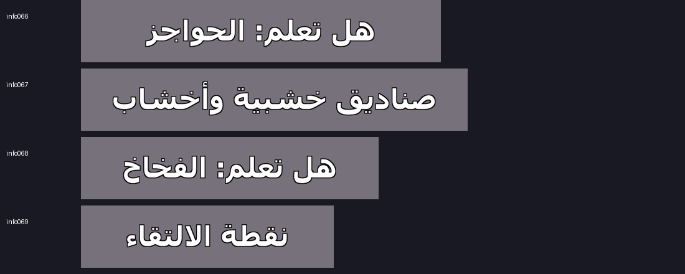
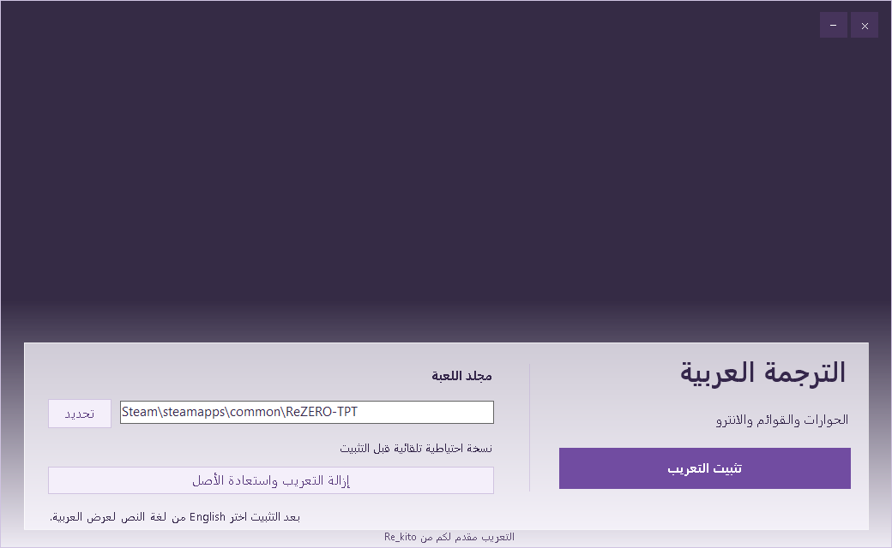

# Re:ZERO − The Prophecy of the Throne Arabic Translation

This repository contains the Windows installer source for the v2.2 Arabic localization. The localization covers dialogue, menus, fonts, and parts of the opening video. The project page is on [Nexus Mods](https://www.nexusmods.com/mods/3?game_id=10431).

`src/Installer.cs` and `src/app.manifest` are byte-for-byte copies of the retained v2.2 inputs. They contain the original WinForms interface, Steam path discovery, installation, backup, and restoration logic. `tools/prepare.py` retains the original CFSI index reader and RZP1 delta encoder. The packaging entry point now takes explicit input paths so it can run outside the original development workspace. The review utilities were added after v2.2 and are separate from the installer.

The preview shows generated translation textures. The interface screenshot below was rendered from the actual WinForms layout with a solid placeholder for the game's key art and a sample Steam path. The change was made for the screenshot only. The game archives, localized video, icon, artwork, embedded payload, and compiled installers are kept outside the public source tree.

## Install and remove the translation

1. Close the game and run the v2.2 installer obtained through an authorized distribution channel. The installer uses the standard Windows administrator prompt.
2. Confirm the detected Steam game folder or select the folder containing `ReZERO-TPT.exe` and `00000000.cfsi`.
3. Click **تثبيت التعريب**. In the game, select **English** as the text language to use the Arabic localization.
4. To remove it, close the game, reopen the installer, and choose **إزالة التعريب واستعادة الأصل**. Keep the `.rezero-arabic-backup` folder until removal finishes.

When moving from a previous version installed with this tool, restore the original files first. The installer expects the exact supported original files and rejects other builds or pre-existing modifications.

## Patch format

The embedded resource `payload.zip` is a DEFLATE ZIP containing a JSON plan, the installer artwork, and individually gzip-compressed RZP1 streams. Each RZP1 stream starts with `RZP1` and a little-endian signed 32-bit output length. Opcode `0` supplies a source offset and a byte count to copy from the user's original file or archive entry. Opcode `1` supplies a byte count and literal bytes. Counts and offsets use little-endian 32-bit integers. The encoder indexes 32-byte blocks of the source and extends matches forward. Literal data can contain localized resources and substantial portions of a replacement asset, which is why the payload itself stays outside this repository.

The v2.2 plan describes 365 modified CFSI archive entries, the English opening video, and an executable delta whose output is identical to its input. The latter uses the same validation and backup path as the other outputs. The original game executable is rewritten with identical bytes.

## Security and Source Verification

- **Before installation.** The installer checks that `ReZERO-TPT` is closed and hashes the original archive, executable, and opening movie using SHA-256. It verifies each source archive entry and each reconstructed output against the embedded plan before it starts writing game files. The checks bind the patch to a specific game build. They do not authenticate the installer or its embedded plan against a publisher key.
- **During installation.** The installer creates `.rezero-arabic-backup` in the selected game directory with the original archive header and length, game executable, movie, and a JSON journal. It appends localized blocks to `00000000.cfsi` and redirects their index entries, writes the reconstructed executable and movie, and checks the written outputs. It attempts restoration if a caught exception interrupts the write phase. A forced process kill or power loss can leave a partial installation or backup. Keep the journal and backup files if an operation fails.
- **During removal.** The installer checks the backup and, for a completed installation, the current archive, executable, and movie against the journal. It restores the archive header and original length, the executable, and the movie. After confirming their original SHA-256 hashes, it removes the backup files it created. A hash mismatch blocks normal removal rather than silently overwriting later modifications.
- **Local access and elevation.** The manifest requests administrator privileges for Steam installations under `Program Files`. The installer reads Steam's registry path and `libraryfolders.vdf`, checks for the game process, and uses two `user32.dll` calls for window dragging. Its outer error handler can write a diagnostic file in the Windows temporary directory. This release is unsigned. The tool expects a trusted local game folder and a trusted release payload.
- **Internet and other changes.** The installer code has no network requests, telemetry, download or update mechanism, shell execution, or child process launch. It does not modify saves, write the registry, install services, or add startup entries. The translation resources are read from the installer itself.
- **Source and binary evidence.** The historical EXE hash, fresh build hashes, embedded payload hash, compiler details, and limits of the comparison are in [the verification report](VERIFICATION.md). The source can be audited publicly. A release-equivalent rebuild requires the exact private payload and icon or access to the reference installer to extract them locally. Reviewers can compare managed code and the embedded resource without running the reference EXE.

Build and inspection commands are in [BUILD.md](BUILD.md). Recorded input hashes are in [release.json](release.json).
